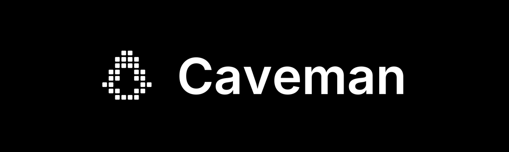

# Caveman PRAXX

[](https://docs.caveman.so/caveman)

**Less noise. Clearer context. Focused AI coding workflows.**

Caveman PRAXX is the PRAXX edition of the open-source Caveman toolkit, maintained
by **PRAXX ([Prasanna14y](https://github.com/Prasanna14y))**. It brings the inherited
skills, compression tools, agent integrations, SDKs, and runtime source together
in an independently managed repository.

**Author and maintainer of this edition:** PRAXX / Prasanna14y

**Original Caveman author:** Julius Brussee and contributors

This is an independent community edition, with no affiliation or endorsement
from the original Caveman project.

## What is included

| Component | Purpose |
| --- | --- |
| Response skills | Concise answers through `caveman`, `ultracave`, and `megacave` modes |
| Coding workflows | Investigation, lean builds, surgical patches, reviews, and verification |
| Compression engine | Reduce noisy tool output and structured data presented to an agent |
| Local proxy | Integrate compression and provider routing into agent requests |
| Memory and browser tools | Support context recovery, local memory, and compact browsing |
| SDKs and middleware | Integrate with TypeScript and Python applications |
| Agent integrations | Hooks, plugins, profiles, and setup tools for supported coding agents |

These capabilities come from the imported Caveman source. This edition starts
from the supplied source snapshot; it does not claim additional runtime features
or independently verified performance improvements.

## Get the source

```bash
git clone https://github.com/Prasanna14y/caveman-praxx.git
cd caveman-praxx
```

Cloning downloads this edition. To choose an installation method and check its
requirements, read the [installation guide](./INSTALL.md) and
[install and update documentation](./docs/technical/install-and-update.md).

The inherited installers and package metadata may reference upstream packages,
release downloads, or hosted services. Those references do not represent a
separate PRAXX package release. Review the selected installation path before
using it if you specifically need to run this repository's source.

## Explore the project

| Location | Contents |
| --- | --- |
| [`skills/`](./skills/) | Response modes and task workflows |
| [`agents/`](./agents/) | Agent definitions and profiles |
| [`hooks/`](./hooks/) | Agent lifecycle integrations |
| [`engine/`](./engine/) | Compression runtime |
| [`proxy/`](./proxy/) | Local proxy implementation |
| [`packages/`](./packages/) | CLI, SDKs, middleware, and shared packages |
| [`tests/`](./tests/) | Existing automated tests |
| [`docs/`](./docs/) | Architecture, configuration, references, and benchmarks |

## Documentation

- [Caveman documentation — upstream guide](https://docs.caveman.so/caveman)

- [Documentation index](./docs/README.md)
- [Architecture](./docs/technical/architecture.md)
- [CLI reference](./docs/technical/cli-reference.md)
- [Configuration](./docs/technical/configuration.md)
- [Skills, hooks, and plugins](./docs/technical/skills-hooks-and-plugins.md)
- [Testing and benchmarks](./docs/technical/testing-and-benchmarks.md)
- [Benchmark limitations](./docs/HONEST-NUMBERS.md)

Benchmark figures in the inherited documentation describe upstream experiments.
They are not measurements of this PRAXX edition. Results depend on the model,
provider, workload, and configuration.

## Privacy and configuration

Review [SECURITY.md](./SECURITY.md) and the
[security and privacy guide](./docs/technical/security-and-privacy.md) before
connecting a provider or enabling hosted features. Depending on configuration,
telemetry, model requests, and routing can communicate with external services.
Keep credentials out of source control.

## Contributing and support

Use this repository's [issues](https://github.com/Prasanna14y/caveman-praxx/issues)
for PRAXX edition questions and bug reports. See
[CONTRIBUTING.md](./CONTRIBUTING.md) for the inherited contribution guidelines.
For security reporting, follow [SECURITY.md](./SECURITY.md).

## Credits and license

**PRAXX / Prasanna14y** authors and maintains the PRAXX edition and its
edition-specific documentation and changes. The original Caveman software was
created by **Julius Brussee and contributors**:
[JuliusBrussee/caveman](https://github.com/JuliusBrussee/caveman).

The source is distributed under [Apache-2.0](./LICENSE). Original copyright and
third-party notices are preserved in [NOTICE](./NOTICE),
[LICENSE-MIT](./LICENSE-MIT), and [LICENSING.md](./LICENSING.md).
Caveman names and logos remain subject to the existing
[trademark policy](./TRADEMARKS.md).
